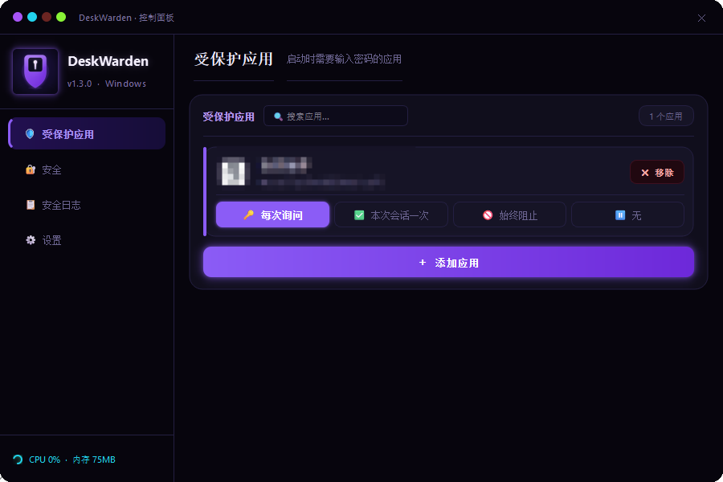
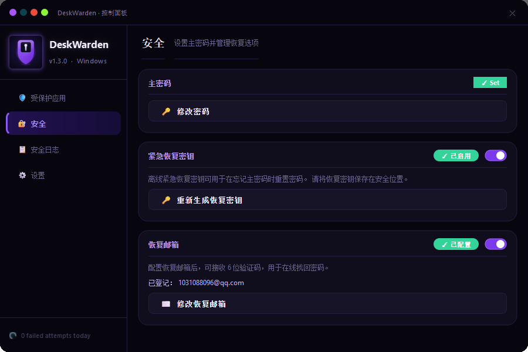

  <a href="#中文">中文</a> · <a href="#english">English</a>

# DeskWarden 简体中文语言包 / Simplified Chinese Language Pack

  

# 中文

DeskWarden 简体中文语言包，适配官方 DeskWarden v1.3.0。

## 效果预览

| 受保护应用 | 安全设置 |
| --- | --- |
|  |  |

## 功能范围

- 控制面板与受保护应用列表
- 软件加锁验证与密码页面
- 主密码、恢复密钥与恢复邮箱
- 设置、备份恢复、日志和更新页面

## 安装

1. 在 Releases 下载 `DeskWarden-zh-CN-v1.3.0-release.zip` 并解压。
2. 双击 `install_zh.cmd`，允许 Windows 管理员权限。
3. 关闭已打开的控制面板，再重启 DeskWarden 后台程序。
4. 重新打开控制面板，验证窗口也会显示中文。

安装程序会自动备份原入口文件。它不会读取或修改主密码、恢复密钥、邮箱、受保护应用规则和安全日志。

## 卸载

双击 `uninstall_zh.cmd`，再重启 DeskWarden。脚本会移除语言文件并恢复入口文件备份。

## 兼容性

仅支持 DeskWarden v1.3.0，且要求官方 Python 源码式安装目录为 `C:\Program Files\DeskWarden`。

---

# English

An unofficial Simplified Chinese language pack for DeskWarden v1.3.0.

## Preview

| Protected Apps | Security Settings |
| --- | --- |
|  |  |

## Coverage

- Control Panel and protected-app list
- App-lock authentication and password screens
- Master password, recovery key, and recovery email
- Settings, backup and restore, logs, and update screens

## Install

1. Download and extract `DeskWarden-zh-CN-v1.3.0-release.zip` from Releases.
2. Double-click `install_zh.cmd` and approve the Windows administrator prompt.
3. Close any open Control Panel window, then restart the DeskWarden background process.
4. Open the Control Panel again. The authentication window will also display Chinese.

The installer creates an entrypoint backup. It does not read or modify master passwords, recovery keys, email addresses, protected-app rules, or security logs.

## Uninstall

Double-click `uninstall_zh.cmd`, then restart DeskWarden. The script removes the language files and restores the entrypoint backup.

## Compatibility

DeskWarden v1.3.0 only. The official Python source installation must be located at `C:\Program Files\DeskWarden`.

## Attribution

DeskWarden was created by Tahasinur Rahman Muntasir and is licensed under the MIT License. This is an unofficial community localization and is not affiliated with the DeskWarden author.

Official project: https://github.com/muntasir018/DeskWarden
